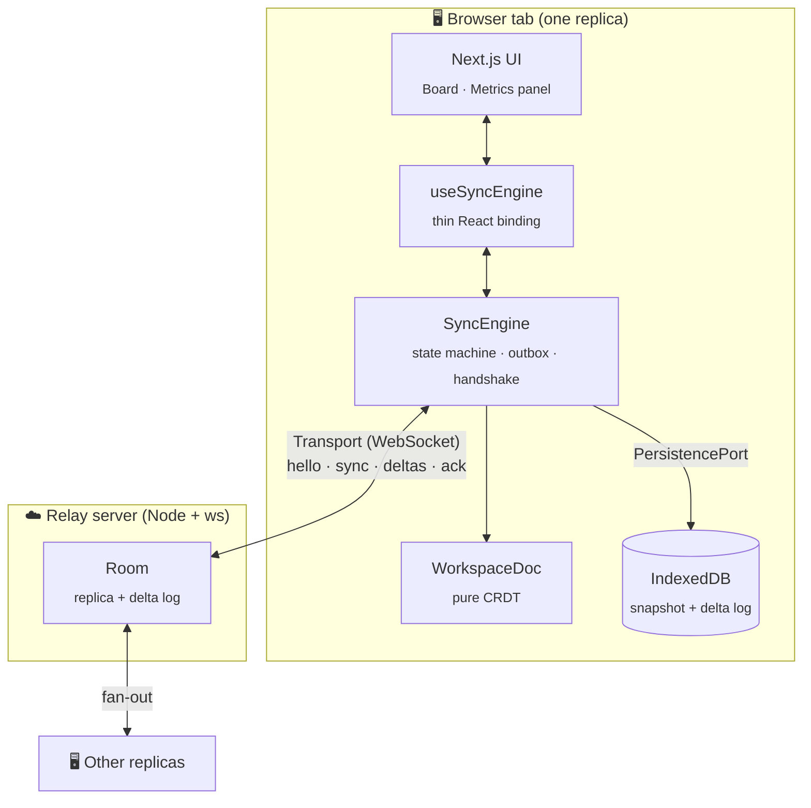
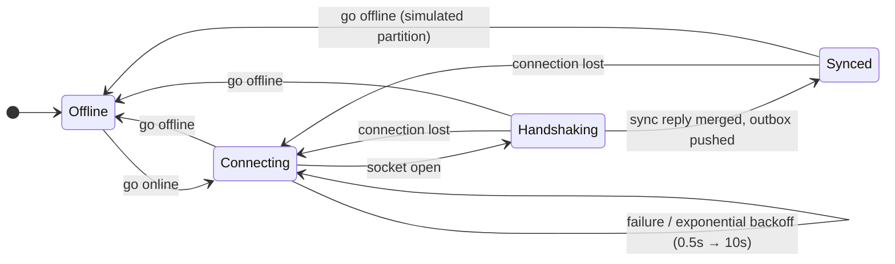
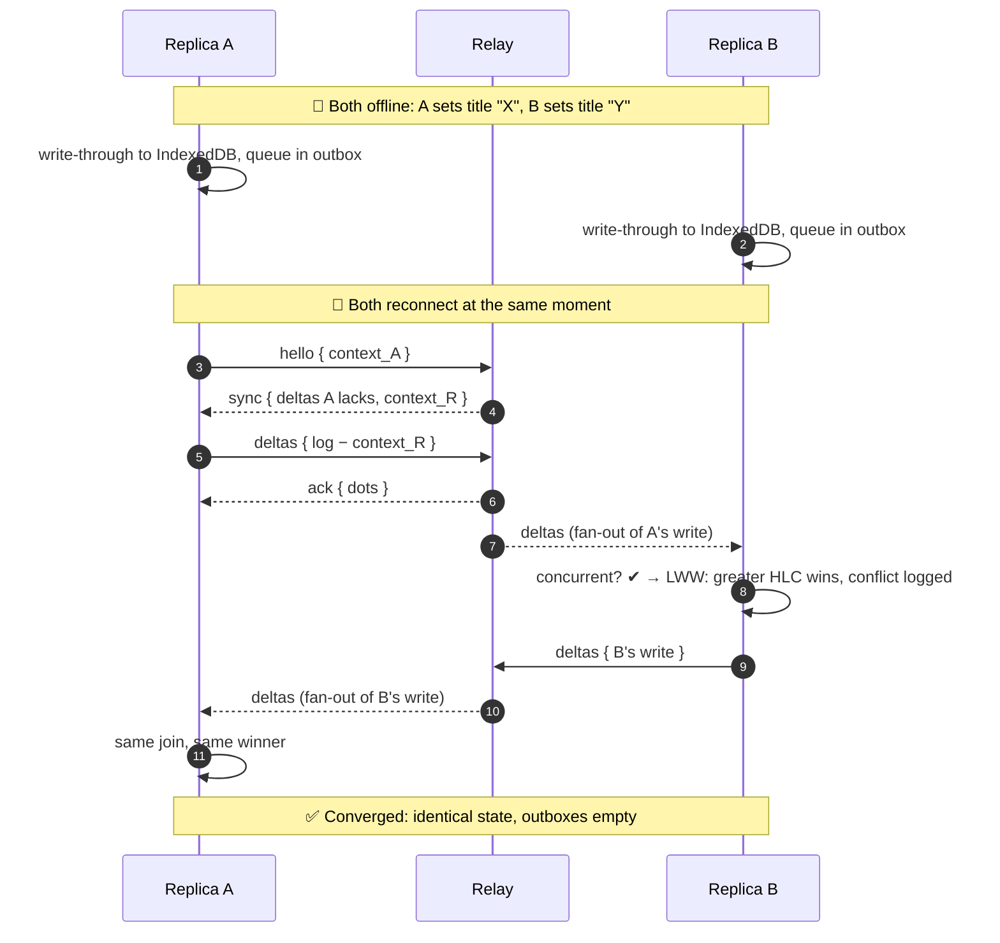

<div align="center">

# 🔀 CRDT Shared Workspace

### An offline-first collaborative Kanban board, powered by a CRDT sync engine built from first principles

*No Yjs. No Automerge. Just math, TypeScript and WebSockets.*

<br/>


<br/>

[Features](#-features) •
[Quick Start](#-quick-start) •
[Architecture](#-architecture) •
[The Math](#-the-math) •
[Sync Protocol](#-sync-protocol) •
[Testing](#-testing) •
[Roadmap](#-roadmap)

</div>

---

## ✨ Features

<table>
<tr>
<td width="50%" valign="top">

### 🧮 Custom CRDT engine
State-based **LWW-Element-Sets** and per-field **LWW-Registers**, ordered by **Hybrid Logical Clocks**. `merge()` is provably associative, commutative and idempotent.

</td>
<td width="50%" valign="top">

### 📴 Offline-first
Every edit is committed **atomically to IndexedDB** before it touches the network. Reload while offline and nothing is lost: the UI hydrates entirely from local storage.

</td>
</tr>
<tr>
<td valign="top">

### 🔌 Partition tolerant
A **Go Offline** toggle simulates a network partition. Mutations queue in an outbox, and reconnecting triggers a background **anti-entropy handshake** driven by vector clocks.

</td>
<td valign="top">

### 🔬 Observable conflicts
A live **systems dashboard** shows vector clocks, latency, the outbox and a conflict log explaining exactly *why* each write won: wall time, logical counter or node-id tiebreak.

</td>
</tr>
<tr>
<td valign="top">

### 🧭 Causally aware
**Dot-set causal contexts** track out-of-order deliveries, so a causal overwrite is never misreported as a conflict.

</td>
<td valign="top">

### ✅ Exhaustively tested
**92 tests**, including property-based proofs of the merge laws, all 120 permutations of a dependent delta chain, and a seeded chaos network that shuffles, duplicates and drops messages.

</td>
</tr>
</table>

---

## 🚀 Quick Start

```bash
git clone https://github.com/Hasnain-Azam/crdt-shared-workspace.git
cd crdt-shared-workspace
npm install
npm run dev        # web app → http://localhost:3000   relay → ws://localhost:4000
```

| Command | Description |
| :--- | :--- |
| `npm run dev` | Next.js dev server + WebSocket relay (hot reload) |
| `npm test` | Full Vitest suite (unit, property-based, scenario) |
| `npm run build` | Production Next.js build + compiled relay in `dist/` |
| `npm start` | Run the production build |
| `npm run typecheck` | Strict type-check of the app, tests and server |
| `npm run lint` | typescript-eslint (`no-explicit-any` enforced) |

### 🎬 Try the conflict demo

> [!TIP]
> Open **two browser tabs** at `http://localhost:3000`. Each tab is an independent replica with its own node id and IndexedDB database.

1. **Create** a card in tab A. It appears instantly in tab B.
2. **Partition:** toggle *both* tabs **Offline**.
3. **Diverge:** rename the same card differently in each tab, and change its color in one of them.
4. **Persist:** reload a tab while it's offline. Your edits are still there.
5. **Heal:** toggle both tabs back **Online** and watch them converge. The conflict log shows the winner, the loser and the reason. The color change survives because it touched a different field.
6. **Shortcut:** hit **⚡** on any card to inject a real concurrent edit from a phantom peer with a skewed clock.

> [!NOTE]
> Add `?room=<name>` to the URL to open separate boards.

---

## 🏗 Architecture

The CRDT core is **pure**: it has zero I/O. Storage and networking sit behind interfaces, so the same engine runs in the browser, in the relay server, and inside an adversarial in-memory network in the tests.



<details>
<summary><b>📁 Project structure</b></summary>

```
src/
├── core/
│   ├── crdt/              # Pure CRDT, no I/O
│   │   ├── hlc.ts             Hybrid Logical Clock
│   │   ├── vectorClock.ts     Causal contexts (vector clock + dot cloud)
│   │   ├── lwwRegister.ts     LWW-Register
│   │   ├── lwwElementSet.ts   LWW-Element-Set
│   │   ├── fractionalIndex.ts Dense ordering keys
│   │   ├── merge.ts           The semilattice join ⊔
│   │   ├── conflict.ts        Concurrency detection & explanations
│   │   ├── workspaceDoc.ts    Replica: mutators → deltas, apply(), merge()
│   │   └── view.ts            State → render-ready board
│   ├── storage/           # PersistencePort, IndexedDB + memory stores
│   └── network/           # Protocol + guards, Transport, SyncEngine
├── client/                # Browser wiring (Web Locks, IndexedDB, WebSocket)
├── hooks/                 # useSyncEngine
├── components/            # Board, Column, Card, MetricsPanel, ConflictLog…
└── app/                   # Next.js App Router
server/                    # Relay: room.ts (transport-agnostic) + index.ts (ws)
tests/                     # crdt/ · scenarios/ · storage/ · network/ · helpers/
```

</details>

---

## 🧮 The Math

### The replicated payload

```ts
DocState = {
  columnSet: LWWElementSet                 // membership (adds/removes → Tag)
  columns:   ColumnId → { title, order }   // each field: LWWRegister
  cardSet:   LWWElementSet
  cards:     CardId   → { title, description, color, position }
}

Tag   = { ts: HLC, dot: (node, seq) }
Delta = { dot, ts, context, patch: DocState }   // context = author's knowledge before the write
```

### 1. Hybrid Logical Clocks give a strict total order

Each write is stamped with $ts = (wall, counter, node)$ and compared lexicographically. The clock never runs backwards, and on receipt it is lifted above every timestamp it observes:

$$
wall' = \max(wall_{local},\ wall_{remote},\ now)
$$

So if write $e$ causally precedes $f$, then $ts(e) < ts(f)$, **even when $f$'s author has a lagging physical clock**. The `node` tiebreak guarantees no two writes ever compare equal.

### 2. Merge is a join-semilattice

| Structure | Join $a \sqcup b$ | Why it's a semilattice |
| :--- | :--- | :--- |
| LWW-Register | $\max_{ts}(a, b)$ | max over a total order |
| LWW-Element-Set | $(A_1 \sqcup A_2,\ R_1 \sqcup R_2)$, per-key max | product of max-semilattices |
| Map of records | pointwise $\sqcup$, missing key $= \bot$ | product of semilattices |
| **DocState** | componentwise $\sqcup$ | **product of all of the above** |

Membership is decided by comparing tags: $\ e \in S \iff A[e].ts > R[e].ts$.

Because every component is a semilattice, `merge()` satisfies:

$$
\underbrace{(a \sqcup b) \sqcup c = a \sqcup (b \sqcup c)}_{\text{associative}}
\qquad
\underbrace{a \sqcup b = b \sqcup a}_{\text{commutative}}
\qquad
\underbrace{a \sqcup a = a}_{\text{idempotent}}
$$

Applying a delta is the *same* join ($state \sqcup patch$), so **delivery order, batching and duplication can never change the outcome**. That is strong eventual consistency.

### 3. Causal contexts are vector clocks that handle gaps

A causal context is a **set of dots**, stored compactly as a contiguous vector clock plus a "cloud" of out-of-order dots:

```
{ clock: { alice: 3 }, cloud: { alice: [5] } }   ⇒   saw alice₁ … alice₃ and alice₅, still missing alice₄
```

Two writes are **concurrent** (a genuine conflict) iff neither author had seen the other:

$$
\text{concurrent}(w_1, w_2) \iff dot(w_1) \notin C_{remote} \ \land\ dot(w_2) \notin C_{local}
$$

### 4. Conflict semantics

| Situation | Resolution |
| :--- | :--- |
| ⚔️ Same field, concurrent writes | Greater HLC wins. The log says whether **wall time**, **counter** or **node id** decided it |
| 🤝 Different fields, concurrent writes | **Both kept**, because fields are independent registers |
| 🗑️ Delete vs edit | Stays deleted. The edit is preserved under the tombstone |
| 🛟 Move into a concurrently deleted column | The card appears in a virtual **Recovered** lane instead of vanishing |
| 📐 Concurrent moves to the same slot | Fractional keys tie-broken by card id, so every replica shows the same order |

---

## 🔄 Sync Protocol

### Connection state machine



### Healing a partition



### Wire messages

| Direction | Message | Purpose |
| :---: | :--- | :--- |
| ⬆️ | `hello { clientId, room, context }` | Starts the anti-entropy handshake |
| ⬇️ | `sync { deltas, context }` | Deltas the client is missing + the server's context |
| ⬆️ | `deltas { deltas }` | Push local or unacknowledged writes |
| ⬇️ | `deltas { deltas, from }` | Live fan-out of another peer's writes |
| ⬇️ | `ack { dots }` | Server holds these dots, so they leave the outbox |
| ⬆️⬇️ | `ping` / `pong` | Round-trip latency |
| ⬇️ | `peers { peers }` | Who is in the room |

> [!IMPORTANT]
> **Guarantees.** Each local mutation is joined in memory, **atomically persisted** (snapshot and delta in one IndexedDB transaction), and only *then* sent. Deltas leave the outbox only when acked. Lost messages are re-pushed on the next handshake, and duplicates are absorbed by idempotent merge. All network input is validated by runtime type guards before use.

---

## 🧪 Testing

```bash
npm test
```

```
 ✓ tests/crdt/mergeLaws.test.ts                 (5 tests)    ACI laws + SEC, fast-check
 ✓ tests/crdt/workspaceDoc.test.ts              (14 tests)
 ✓ tests/crdt/vectorClock.test.ts               (8 tests)
 ✓ tests/crdt/lwwPrimitives.test.ts             (7 tests)
 ✓ tests/crdt/hlc.test.ts                       (7 tests)
 ✓ tests/crdt/fractionalIndex.test.ts           (6 tests)
 ✓ tests/scenarios/offlineConcurrentEdit.test.ts (4 tests)
 ✓ tests/scenarios/outOfOrderDelivery.test.ts   (8 tests)
 ✓ tests/scenarios/partitionHeal.test.ts        (4 tests)
 ✓ tests/storage/workspaceStore.test.ts         (6 tests)
 ✓ tests/network/syncEngine.test.ts             (10 tests)
 ✓ tests/network/protocol.test.ts               (9 tests)
 ✓ tests/network/serverRoom.test.ts             (4 tests)

 Test Files  13 passed (13)
      Tests  92 passed (92)
```

| Suite | What it proves |
| :--- | :--- |
| **Merge laws** | Associativity, commutativity and idempotency, plus convergence under random schedules, shuffles and duplicates. The random states come from *real* replicas, not synthetic JSON |
| **Offline concurrent edit** | Users A and B edit the same field offline and reconnect simultaneously. Checks the correct winner, a conflict logged on both sides, preserved non-conflicting fields, exact-tie node tiebreaks, clock skew, and delete-vs-edit |
| **Out-of-order delivery** | Every one of the **120 permutations** of a dependent delta chain, gap folding in causal contexts, and seeded chaos networks. Dropped fan-out is recovered by anti-entropy |
| **Partition heal** | Split brain, store-and-forward between peers never online together, relay restart, rapid on/off flapping |
| **Storage** | IndexedDB round-trips, hydration *before* any network I/O, outbox persistence across reloads |
| **Network** | Protocol guards, relay semantics, state transitions, backoff, RTT, stale-socket isolation |

> [!NOTE]
> The suite has been mutation-checked: breaking the LWW comparison causes **14 tests to fail** across unit, property and scenario suites.

---

## ⚙️ Configuration

| Variable | Default | Used by |
| :--- | :--- | :--- |
| `SYNC_PORT` | `4000` | Relay server |
| `NEXT_PUBLIC_SYNC_URL` | `ws://<page host>:4000` | Browser client |

The relay also exposes `GET /health` and `GET /rooms/<id>` (a JSON summary of a room's merged state) for debugging.

---

## 🗺 Roadmap

- [ ] Durable relay storage (today clients re-push their history after a relay restart)
- [ ] Garbage-collect tombstones and acked deltas once they are causally stable
- [ ] Sequence CRDT (RGA) for character-level merging of card descriptions
- [ ] Room authentication and access control
- [ ] Peer-to-peer transport over WebRTC

---

<div align="center">

**Built by [Hasnain Azam](https://github.com/Hasnain-Azam)** · MIT License

</div>
